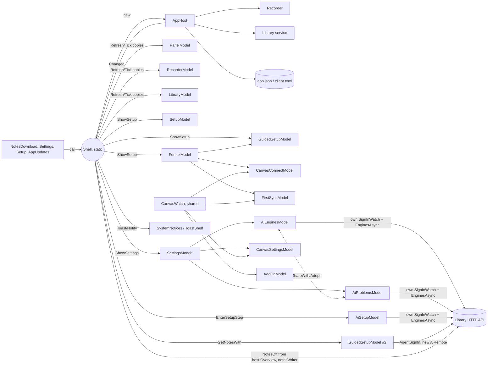

# How the Syft Notes desktop app fits together

Written 2026-11-03 from main at 0.22.0. Paths are under `engine/src/StudyStash.App/` unless they say otherwise. Section 1 and 2
are how things stood then; the toolkit (3) and rules (4) are where the code is going, piece by piece (5).
This covers how the pieces connect and which shared pieces ("the toolkit") new code uses. `docs/DESIGN.md` covers the
look.

## 1. The map today

**Who creates whom.** `Program` → `Shell.Start` (static; Shell*.cs, about 5,400 lines, 98 static fields, 13 window
fields). Shell creates the one `AppHost` (Services/AppHost.cs: recorder, local library, Whisper, Granola, Drive,
calendars, settings). It holds four view models for the life of the app (`PanelModel`, `RecorderModel`, `QuickModel`,
`LibraryModel`). It builds every window by hand, builds most page models itself, and wires them with lambdas
(`Wire()`, Shell.cs:507).

**How data arrives.** There are three ways, often mixed in one screen:
- *Push from Shell.* `AppHost.Changed` → `RequestRefresh` (throttled to 100 ms) → `Refresh()` (Shell.cs:1858) copies
  host state into the panel, the pill and the library model. `Tick()` every 250 ms copies the recording time and levels.
- *Pull by the view model.* A model calls the library's HTTP API itself (`IAiLibrary`, `RemoteLibrary`, `CanvasClient`).
- *Poll loops.* About a dozen hand-written `while … Task.Delay` loops (SignInWatch, AiConnect, AiEnginesModel,
  AiAccessModel, AttachmentsModel, ListenModel, ListenVoicesModel, AppHost's library check, CanvasWatch, DailyCount…).

**Library clients.** `host.Remote()` makes a new `RemoteLibrary` on every call (AppHost.cs:477; 47 call sites).
`Shell.Ai()` makes a new `AiRemote` on every call (Shell.Library.cs:639). Settings and guided setup make their own
(Services/Settings.cs:423, Services/GuidedSetup.cs:177,197). `CanvasContext.For` and `Setup.cs:423` each make a
`CanvasClient`. They do share one static `HttpClient`, but the address, password and error handling are worked out
again at each site.


`*` SettingsModel lives in `Services/Settings.cs`, but it is a view model.

**Per feature:**
- **Setup / funnel.** `ShowSetup` (Shell.cs:1287) picks the funnel (`ShowWelcome`) or setup by hand. `FunnelServices`
  and `GuidedServices` are lambda records filled in by Shell, which is a good pattern. Four wizards keep their own step
  lists: `SetupStep`, `FunnelStep`, `GuidedScreen`, and `CanvasConnectModel`'s numbered `Current`. `CanvasConnectModel`
  is built in four places (Shell.Canvas.cs:359, Shell.cs:1494, 1554, 1622).
- **AI engines / sign-in.** The library's AI state (`AiOverview`) is fetched and kept separately in **eight** places:
  AiEnginesModel, AiProblemsModel, AiSetupModel, AiAskModel, AiNotesModel, GuidedSetup/GuidedSetupModel (its own CLI
  sign-in through `AgentSignIn`), Shell's `NotesOff` (read from the `host.Overview` JSON) and `notesWriter`, and
  WelcomeCardModel's `NeedsAi`. Three `SignInWatch` loops run side by side. Settings syncs two of them by hand
  (`Engines.ShareWith(AiProblems)`, Settings.cs:447). This is the top cause of repeat fixes.
- **Library / notes.** AppHost checks the library every 10–20 s. Shell loads pages (`ShowHomeAsync`,
  `ShowLectureAsync`…), parses the raw JSON in Shell (`S(JsonNode)`), and builds `OverviewModel` / `NoteModel`.
  `RequestLibraryReload` is called from about 20 places.
- **Recording.** `host.Recorder` is the truth. Shell copies `Elapsed`, `Levels`, `IsPaused`, `ClassName` and `ClassDot`
  into *both* `PanelModel` and `RecorderModel`, and `Waveform.Live` is a static hook.
- **Canvas / Due.** `CanvasWatch` (Services/CanvasWatch.cs) is the one real shared store: one timer, a `Changed`
  event, `Hurry()`. The AI side should copy it.
- **Ask.** `AiAskModel(Ai())` is built in three places with different wiring (Shell.cs:817, Shell.Library.cs:535,
  Shell.Overview.cs:392).
- **Settings.** `SettingsModel.Make` builds about 12 sub-models with closures over `host`, and it calls back into
  Shell (`ShowCanvasConnect`, `RunSetupAgain`, `Quit`). Settings values themselves go through one path:
  `host.Settings` / `host.Save(...)` (36 writes, 95 reads) and `host.Client()` / `SaveClient`. Keep that.
- **Toasts.** One way in (`Shell.Toast` → `Notify` → system notifications or `ToastShelf`), which is good. But
  services call `Shell.Toast` directly (NotesDownload.cs ×5), so Services depends on Shell.

## 2. What is built more than once

| Pattern | Count | Examples |
|---|---|---|
| AI state fetched/held | 8 holders, 3 `SignInWatch`, 53 reads of `"not_signed_in"` in 7 files | AiEnginesModel.cs:335,432; AiSetupModel.cs:70,273; AiProblemsModel.cs:67,112 |
| AI row/card types | 3 row models, same state → words/button mapping | `AiEngineRow` AiEnginesModel.cs:40, `AiSetupRow` AiSetupModel.cs:12, `AiProblem` AiProblemsModel.cs:11 |
| Sign-in flows | 4 | AiEnginesModel.cs:805 (+AiConnect), AiSetupModel.cs:584, AiProblemsModel.cs:220, GuidedSetupModel.cs:767 (`AgentSignIn`) |
| Busy/Say/Offline/OlderLibrary by hand | 14 VMs with `Busy`, 38 `Busy = true`, 5 with Offline+OlderLibrary | AiSetupModel.cs:588 `ActAsync`, AiEnginesModel.cs:426 |
| Library error catches | 101 `HttpRequestException` in 37 files, 102 `LibraryRefusedException` in 29 | the error text is `ex.Message`, `Sentence()` or `Words()` depending on the file |
| Poll / wait loops | ~12 loops, 24 `Task.Delay` outside the self-test | SignInWatch.cs:40, AiConnect.cs:212, AiEnginesModel.cs:903, AttachmentsModel.cs:115 |
| Wizards | 4 step models, 3 step-indicator classes | SetupModel.cs:11/46, FunnelModel.cs:11/26, CanvasConnectModel.cs:11/15, GuidedSetupModel.cs:15 |
| Self-test route | hard-coded `NextCommand` order | SelfTest.cs:314–411, 422–470 |
| Windows built by hand | 7 `new Window` blocks + a hand-kept Dock list | Shell.cs:1086,1315,1430,1723; Shell.Canvas.cs:374; Shell.GetNotes.cs:40. `UpdateDock` (Shell.cs:1781) leaves out the Get-ready window |
| Mac/Win copies | 38 pairs; 12 differ in under 15% of lines (2,814 lines each side) | MacGuidedSetup 699 lines / 34 differ, MacFunnel 377/16, MacSetup 534/65, MacGetReady 154/14 |
| Confirmations | 1 shared `ConfirmCard` (library only), 7 hand-made `Confirming*` flags, own delete dialogs | LibraryModel.cs:305; Settings.cs:138,140,189; LibrarySettingsModel.cs:219,247 |
| Copy / open URL hooks | 5 `Copy` hooks, 12 `OpenUrl` hooks, 2 ways to reveal a folder | SetupModel.cs:795, AiAccessModel.cs:149; CanvasContext.cs:72 vs `Machine.Open` |
| Wording spread | 1,034 literal strings in 71 .axaml files; "library offline" in 24 files with two wordings; "No AI for now" in 11 files; brand names mapped in ~8 places | AiConnect.cs:70, AiWords.cs:155,179 |
| Time/count formatting | ~10 "when/ago" helpers, 17 inline plurals | Shell.cs:2057, Shell.Library.cs:366, CanvasWords.cs:38–59, OverviewModel.cs:514 |
| Empty states | 24 hand-made blocks | Overview.axaml, Mac/WinPhones, SettingsView |

## 3. The toolkit

What exists today, what is in review, and what is still to build. Use what exists. For a piece that isn't built yet,
build it here, as described, the first time a change needs it, instead of making one more copy in a screen.

| Piece | Status |
|---|---|
| `CanvasWatch` (the one shared Canvas store), `Tips.WhenCut`, `BySkin`, `Icon`, `AppMark`/`SyftMark`, `SyftLoader`, `ConfirmCard` | exist |
| `UiTasks.Run` / `RunQuietly` (work started without waiting: logged, and the student told), `Windows/AppWindows` (every window), `PageState` (which page is open) | in review: branch `toolkit-shell` |
| `Poll`, `LibraryApi` + `Outcome`, `AsyncAction`, `AiStatusStore` (items 1–4) | in review: branch `toolkit-ai-status` |
| `StepFlow`, `Words/` catalogue, `StatusRow`, `AppActions`, `Confirm`, `Format`, shared Mac/Win views (items 5–12) | to build (section 5) |


Shared view-model pieces go in `ViewModels/Kit/`, shared controls in `Controls/`, stores in `Services/Stores/`, and
all words in `Words/`. Each piece has one focused test.

1. **Stores: one source of truth per thing** (`Services/Stores/`). Built on `CanvasWatch`'s pattern.
   ```csharp
   public abstract class Store<T> { T? Current; Reach Reach /*Ok, Offline, OlderLibrary*/; event Action Changed;
     Task RefreshAsync(); IDisposable Hurry(); }      // one loop per store, fast while something is pending
   public sealed class AiStatusStore : Store<AiOverview> {
     AiEngineStatus For(string id);                    // typed: Brand, State enum, SignIn, Tone, Words, Action
     Task<Outcome> ActAsync(string id, AiAction a);    // SignIn, SignInAgain, Check, Start, Download, Connect
     bool NotesOff { get; } string NotesWriter { get; } }
   ```
   `AppHost` owns `Ai`, `Canvas` (the existing `CanvasWatch`) and `Recording` (one state for the panel and the pill).
   View models take the store in their constructor, subscribe to `Changed`, and keep *derived* rows only.
   `SignInWatch`, `ShareWith` and `Adopt` go away. *First:* AiProblemsModel + AiEnginesModel. *Test:* with
   `FakeAiLibrary`, a sign-in finishes; both the Settings row and the problem card show ready after one poll, and only
   one loop ran.
2. **LibraryApi + Outcome** (`Services/LibraryApi.cs`). `host.Api.Library`, `.Ai`, `.Canvas`: built once and rebuilt
   when the address changes; the password is read each time (as Settings.cs:423 does).
   `Task<Outcome<T>> LibraryCall.Run<T>(Func<Task<T>>)` turns offline, too-old and refused into one
   `Failure` with words from the catalogue. *First:* `Shell.Ai()`, Settings.cs:423, GuidedSetup.cs:177.
   *Test:* refused, timeout and null each map to the right `Failure`.
3. **AsyncAction** (`ViewModels/Kit/AsyncAction.cs`): busy, error and cancel in one object.
   ```csharp
   public sealed partial class AsyncAction : ObservableObject { bool Busy; string? Say; Tone Tone;
     IAsyncRelayCommand Command; Task RunAsync(Func<CancellationToken, Task<Outcome>> work); void Cancel(); }
   ```
   `<c:BusyLine Action="{Binding Save}"/>` shows `SyftLoader` and the line under it. It ignores a second press while
   busy. *First:* AiSetupModel `ActAsync`, AiEnginesModel actions. *Test:* a failing call sets `Say` from the
   catalogue and clears `Busy`; Cancel stops it.
4. **Poll** (`Services/Kit/Poll.cs`). `Poll.UntilAsync(check, every, timeout, ct, TimeProvider)` and
   `Poll.Every(...) : IDisposable`. This is the only place allowed to wait; tests pass a fake `TimeProvider`.
   *First:* AiConnect's sign-in wait, AiEnginesModel's apps watch, AttachmentsModel. *Test:* it returns as soon as
   the check is true, and gives up at the timeout with a fake clock.
5. **StepFlow — wizards** (`ViewModels/Kit/StepFlow.cs`).
   ```csharp
   public sealed partial class StepFlow<TStep> : ObservableObject where TStep : struct, Enum {
     IReadOnlyList<TStep> Steps; TStep Current; bool Is(TStep s); bool CanGoBack, IsLast;
     ObservableCollection<StepDot> Indicator;          // Done / Current / Skipped
     Func<TStep, Task<bool>>? Leave; event Action<TStep> Entered;
     Task NextAsync(); void Back(); void GoTo(TStep s); void Include(TStep s, bool on); }
   public static Task DriveAsync<TStep>(this StepFlow<TStep> f, IReadOnlyDictionary<TStep, Func<Task>> drivers);
   ```
   The self-test and the tests give a driver per step and walk whatever steps the flow has. A step with no driver
   fails as "no driver for step X". It never presses Next in a fixed order. Views bind `Flow.Current` with one
   converter, not 15 `OnX` properties. *First:* FunnelModel and `RunOneComputerSetupAsync`, then CanvasConnectModel,
   then GuidedScreen. SetupModel's by-hand flow is frozen, so it moves only if it has to. *Test:* a flow with an
   optional step: the driver walks it, Back works, and a `Leave` guard that says no keeps the step.
6. **Words catalogue** (`Words/*.cs`). It grows from the existing `AiWords`, `CanvasWords`, `NoticeWords`,
   `ToastWords`, `CalendarWords` and `KeyWords`. `Words.Common` holds Try again, Copied, Cancel and
   LibraryOffline (one wording). `Words.Ai` holds `Brand(id)` (the only id → name map), `State(...)` and
   `Action(...)`. XAML uses `Text="{x:Static w:Common.TryAgain}"`. *Test:* no new test; a CI check stops the literal
   count from growing.
7. **StatusRow control** (`Controls/StatusRow.cs` + `ViewModels/Kit/StatusItem.cs`).
   `Icon`, `Title`, `Detail`, `Tone`, `Action`/`ActionLabel`, `Secondary`, `Link`, `Busy`/`Progress`, `Closable`.
   It reuses `Icon` (brand marks), `SyftLoader`, `Tips` (a shortened title shows in full on hover) and
   `SpokenButtons`. Text wraps to two lines instead of clipping. Mac and Windows looks come from styles, not separate
   controls. *First:* AI problem card, Settings AI rows, setup AI rows, then Canvas status and the panel's problem
   line. *Test:* one `AvaloniaFact` draws the longest catalogue strings at the narrowest width in both looks and
   checks nothing is cut.
8. **AppWindows — the platform window service** (`Windows/AppWindows.cs`).
   ```csharp
   Window Open(WindowSpec s); // Key (one per key: a second call brings it to the front), Title, View, Size
                              // (Follow | Fit | Centred), Kind (Main | Dialog | Floating | Notice), Activate,
                              // Near (Placement), InDock; when closed, disposes the DataContext
   bool AnyInDock { get; }    // replaces the hand-kept UpdateDock list
   ```
   It wraps what already exists: `Look.Apply`, `MacTitleBar`, `WinChrome`, `AppMenu.Attach`, `Floating` (showing
   without taking focus, clicks through, above full screen), `Placement`, `Desktop.Activate` and `FollowView`/`FitTo`.
   *First:* Get-ready, then Canvas connect, Settings, setup. *Test:* opening twice with one key gives one window;
   closing it disposes the model and updates `AnyInDock`.
9. **AppActions** (`Services/AppActions.cs`). One record handed to view models, like `FunnelServices`:
   `OpenUrl`, `RevealFolder`, `CopyAsync(text)` (it says "Copied" through the catalogue), `Toast(...)`,
   `ShowSettings(section)`, `ShowCanvasConnect()`. It replaces 12 `OpenUrl` and 5 `Copy` hooks and services calling
   Shell. *Test:* none; tests pass a fake.
10. **Confirm** (`ViewModels/Kit/Confirm.cs` + `Controls/ConfirmHost`). `Task<bool> AskAsync(ConfirmAsk)` grows from
    LibraryModel's `ConfirmAsk` and `ConfirmCard`; each window has one `ConfirmHost`. *First:* the 7 `Confirming*`
    flags, then the delete-lecture dialog. *Test:* Escape answers false.
11. **Format** (`Words/Format.cs`). `When(at, now, zone)`, `Ago`, `Clock` (TimedText), `Size(bytes)`,
    `Count(n, noun)`. *First:* `Shell.When`, `Shell.NoteWhen`, the CanvasWords date helpers, `PhoneGoogleModel.Plural`.
    *Test:* one table of cases.
12. **Shared views over skin styles.** One view per screen; the look comes from `BySkin` (it already exists) or a
    small `SkinStyles` include (Mac or Win styles file). *First:* the 12 near-identical pairs, starting with GetReady,
    AiSetup and Funnel. *Test:* the existing shots.

## 4. Connection rules

`tools/check-connections.sh` counts the patterns behind these rules (fixed waits, engine-state strings outside the store,
Shell in services, windows built by hand, bare catches, fire-and-forget calls in Shell, Mac views, literal colours
and text sizes in views, clients made by hand). CI's "Connection rules" job fails when a count rises above `tools/connections-baseline.txt`; when a change
brings one down, lower its line in the same change. Rules without a count are kept by review.

1. **One owner per shared thing.** AI state, Canvas state, recording state and settings live in a store on
   `AppHost`. A view model holds only rows built from a store, never its own copy or its own loop.
   *Check:* `EnginesAsync(`, `SignInAsync(` and `new SignInWatch` appear only in `Services/Stores` and `AiConnect`.
2. **Engine states are read in one place.** `"not_signed_in"` and the other engine-state strings appear only in
   `AiStatusStore` and `Words/Ai`. *Check:* grep.
3. **View models get what they need from their constructor or a `*Services` record.** Never from `Shell`, never by
   making a client. *Check:* no `Shell.` in ViewModels (it is 0 today; keep it there); no `new (HttpClient|AiRemote|RemoteLibrary|CanvasClient)`
   outside `LibraryApi`.
4. **Views and controls don't call services.** No `Shell.`, `Dialogs.`, `Process.`, `host.` or `Machine.` in
   `Views/` or `Controls/`; links go through `AppActions`. *Check:* grep (NoteView.cs:97 is the one to move).
5. **Services never call Shell.** They return results or raise events. *Check:* no `Shell.` in `Services/` (16 today, in 4 files).
6. **Shell only opens windows and connects stores to the top-level models.** No JSON parsing, no library calls, no
   page building in Shell. *Check:* the counts of `Remote()`, `JsonObject` and `JsonNode` in Shell*.cs only go down.
7. **Windows open through `AppWindows`.** *Check:* no `new Window` or `new Floating` outside `Windows/`.
8. **Mac and Windows share one view model; a view pair only where the layout really differs.** New screens are one
   view. *Check:* the Mac*.axaml count doesn't grow, and a pair that differs in under 15% of lines fails.
9. **Every word a student reads comes from `Words/`.** *Check:* the literal `Text=`/`Content=` count in .axaml and the
   literal `Say = "` count in .cs don't grow.
10. **Wizards are a `StepFlow`; tests and the self-test drive them by step.** *Check:* no `NextCommand.Execute` in
    SelfTest*.cs outside `DriveAsync` drivers.
11. **No fixed sleeps.** Waits go through `Poll` with a real condition and a timeout. *Check:* no `Task.Delay` or
    `Thread.Sleep` outside `Kit/Poll.cs` and an allow-list of animation controls.
12. **Every action a student starts goes through `AsyncAction`.** No bare `catch { }`, no `Busy = true` by hand.
    *Check:* grep.
13. **The look comes from the Syft look's tokens (`Skin.cs`).** Colours by meaning (`Accent`/`OnAccent` ink on paper,
    paper on ink in dark; `Recording` coral, only for recording; `Selected`/`OnSelected` lilac with ink; `Progress`
    sky on `ProgressTrack`; `Highlight` mustard; `SurfaceRaised` the mesh; `Border`, `TextMuted`, `TextFade1`–`3`),
    text by the type scale (`FontCaption` 12, `FontBody`/`FontBodyStrong` 14, `FontSubtitle` 16, `FontTitle` 20,
    `FontDisplay` 28), gaps by `Space1`–`Space8` and `Inset1`–`Inset8` (4-point), corners by `RadiusCell`,
    `RadiusControl`, `RadiusCard`, `RadiusPanel`, and every button's corners by `c:Cell.Round` (the logo's cell, 27 % of
    its height). No colour themes; light, dark or the system's. *Check:* the `literal-colours` (#hex in Views and
    Controls, outside Syft.cs) and `literal-font-sizes` (a number in a view's `FontSize`) counts only go down;
    ThemeTests checks every token exists light and dark and every text and fill pair reads at 4.5:1.

## 5. Migration order

Each step is one branch, is safe to ship alone, and leaves the app working.

1. `kit-basics`: Poll, Format, LibraryApi + Outcome, AsyncAction, and `check-connections.sh` with today's counts as
   the baseline. Nothing visible changes.
2. `ai-store`: AiStatusStore on AppHost; AiProblemsModel and AiEnginesModel use it; ShareWith, Adopt and two
   SignInWatches go away.
3. `ai-store-setup`: AiSetupModel, Shell's `NotesOff`/`notesWriter` and WelcomeCard `NeedsAi` read the store.
4. `ai-store-ready`: when guided setup's / Get-ready's sign-in ends, it refreshes the store, and `ReadyForNotes`
   reads it. The four sign-in flows become one `ActAsync`, plus the CLI's own login only where the library isn't
   involved yet.
5. `status-row`: the StatusRow control; first the AI problem card and the Settings AI rows (both looks), then the
   setup rows.
6. `words-ai`: AI and library-offline words and brand names in `Words/`; then the ratchet is switched on.
7. `stepflow-funnel`: FunnelModel on StepFlow and the self-test's one-computer route on drivers. Then
   `stepflow-canvas` (CanvasConnectModel), then `stepflow-guided`. By-hand setup is last, and only if it has to.
8. `app-windows`: AppWindows; move Get-ready, Canvas connect, Settings and setup; `UpdateDock` becomes `AnyInDock`.
9. `shared-views-N`: merge one near-identical Mac/Win pair per branch (GetReady, AiSetup, Funnel, Welcome,
   GuidedSetup…).
10. `app-actions` and `confirm`: OpenUrl, Copy, Reveal and Toast through AppActions; Services stop calling Shell;
    the Confirming* flags move to Confirm.
